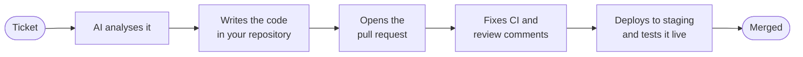

<div align="center">

<picture>
  <source media="(prefers-color-scheme: dark)" srcset="assets/logo-dark.svg">
  
</picture>

<br><br>

### From ticket to merged pull request, with AI.

A local dashboard where AI agents write the code, open the pull request and fix CI,<br>
while you stay in control from a Kanban board.

<br>

[](../../releases/latest)
[](../../releases)


<br>

**[⬇ Download](../../releases/latest)** &nbsp;·&nbsp; [Website](https://volath.com) &nbsp;·&nbsp; [Pricing](https://volath.com/pricing) &nbsp;·&nbsp; [Get started](https://volath.com/getting-started) &nbsp;·&nbsp; [FAQ](https://volath.com/faq)

</div>

<br>

> [!NOTE]
> **This repository publishes the Volath apps.** It holds the installers and the release notes, and installed apps look here for updates. The source code is not public. For questions, see [Support](#support).

## How it works

You write a ticket. Volath does the rest, and shows you every step.



You can hold the AI back before it develops, before the pull request, or before the merge, until you approve.

Volath runs on your own machine. Your code, tickets and settings stay in a local database. It uses the AI you already have: a command line tool such as **Claude Code**, **Codex**, **GitHub Copilot** or **OpenCode**, or an API key for **Anthropic** or **OpenAI**.

## What you get

| | |
| --- | --- |
| 🗂 **Kanban board** | Every ticket from *To Do* to *Merged*, with analysis, validation criteria, activity log, cost, comments, pull request and test results. |
| 🤖 **AI development** | Analysis, implementation, review rounds, automatic CI fixing and answers to review comments. Pick the provider and model globally, per project or per ticket. |
| 🧩 **Agents, skills and squads** | Roles with their own instructions, reusable playbooks, and a leader with members for bigger work. |
| ✋ **Approval gates** | Hold any step until a human approves it, or auto-run only tickets you have labelled safe and under a spending limit. |
| 🧪 **Live testing** | After a staging deploy, a real browser tests your environment and keeps the screenshots. |
| 🩺 **Code health** | Errors, code quality issues and dependency alerts, each of which can become a ticket. |
| 🗺 **Project planner** | Describe a project and add documents, and the AI creates the tickets and subtasks. |
| 🔌 **Git hosts** | GitHub, GitLab (including self-hosted) and Bitbucket. |

More on the [features page](https://volath.com/features).

## Download

Get the file for your system from the **[latest release](../../releases/latest)**.

| System | File |
| --- | --- |
| **Windows** | Installer (`.exe`) |
| **macOS**, Apple silicon (M1 and newer) | Disk image (`.dmg`) |
| **macOS**, Intel | Disk image (`.dmg`) for Intel |
| **Linux** | `AppImage`, or the Debian package (`.deb`) |
| **Any system**, in your browser | Portable version (`.zip` on Windows, `.tar.gz` elsewhere) |

The portable version runs without Electron: unpack it, start it, and Volath opens in your browser. It uses the same data as the desktop app.

## Install

Nothing else has to be installed for Volath itself.

<details>
<summary><b>Windows</b></summary>

<br>

Run the installer. If Windows shows *Windows protected your PC*, choose **More info**, then **Run anyway**.

</details>

<details>
<summary><b>macOS</b></summary>

<br>

Open the disk image and drag Volath to **Applications**. If macOS says the developer cannot be verified, right-click the app, choose **Open**, then confirm.

</details>

<details>
<summary><b>Linux</b></summary>

<br>

Make the AppImage executable and run it:

```bash
chmod +x Volath-*.AppImage
./Volath-*.AppImage
```

Or install the `.deb` with your package manager.

</details>

> [!NOTE]
> The installers are not code-signed yet, which is why the first launch can show a security warning. Code signing is planned.

## First launch

1. **License key:** the setup wizard opens. Paste the key from your customer account, or restore a backup.
2. **Administrator:** create the administrator account of this Volath.
3. **Your AI:** choose a command line tool you already use, or enter an API key.
4. **First project:** add the git repository you work on and create a ticket.

Besides Volath you need Git in your `PATH`, at least one AI provider, and a token for your Git host with access to the repositories you work on.

## License keys and plans

Volath needs a license key, which you get with an account at **[customers.volath.com](https://customers.volath.com)**. Plans differ in seats, projects and features: see [Pricing](https://volath.com/pricing). A key can be split into keys of its own, each with chosen seats and projects.

The app checks the key with the license server every so often. If the server cannot be reached, the app keeps working for up to 72 hours from the last successful check.

## Updates

The app updates itself from this repository's releases. On macOS, where the app is not code-signed, it opens the download page for the new version instead of installing it in place.

## Your data and privacy

- 🔒 Your code, tickets and settings stay on your machine.
- 🔑 The app talks to the license server to check your license. It sends your license key, an identifier for this install, the app version and the number of active users, and receives a signed answer.
- 🤝 Calls to AI providers and to your Git host go directly from your machine, with your own keys.

Read the [privacy policy](https://volath.com/privacy) and the [terms of service](https://volath.com/terms).

## Support

- **Plans, licenses or setup:** [support@volath.com](mailto:support@volath.com), or the [contact form](https://volath.com/contact).
- **Something broken?** Open an [issue in this repository](../../issues) with your system, the Volath version and what happened.

## License

Volath is proprietary software. The apps in this repository's releases are licensed to you under the terms in [LICENSE](LICENSE), together with a valid license key.

<div align="center">
<br>

Copyright © 2026 Volath. All rights reserved. &nbsp;·&nbsp; Powered by [RIFT](https://riftweb.com)

</div>
